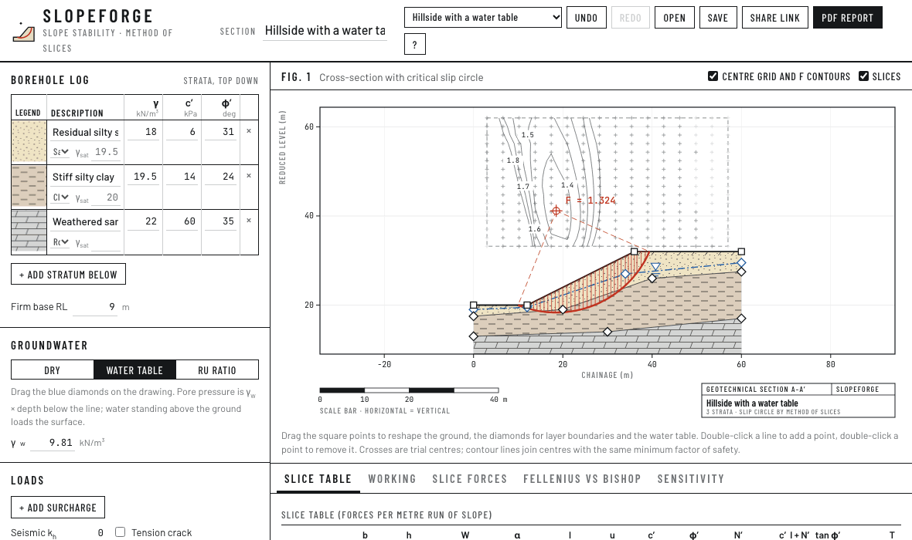
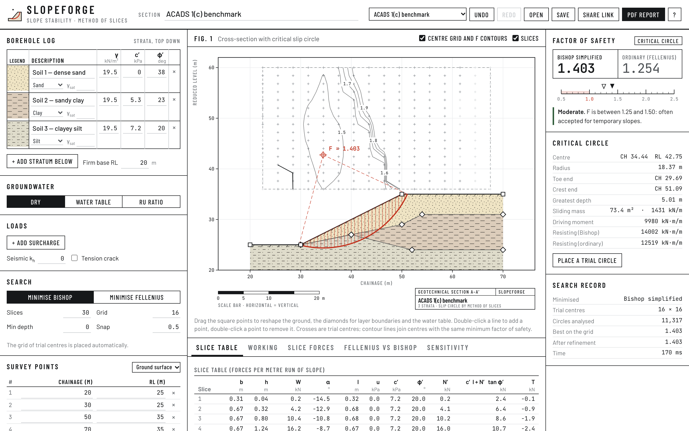
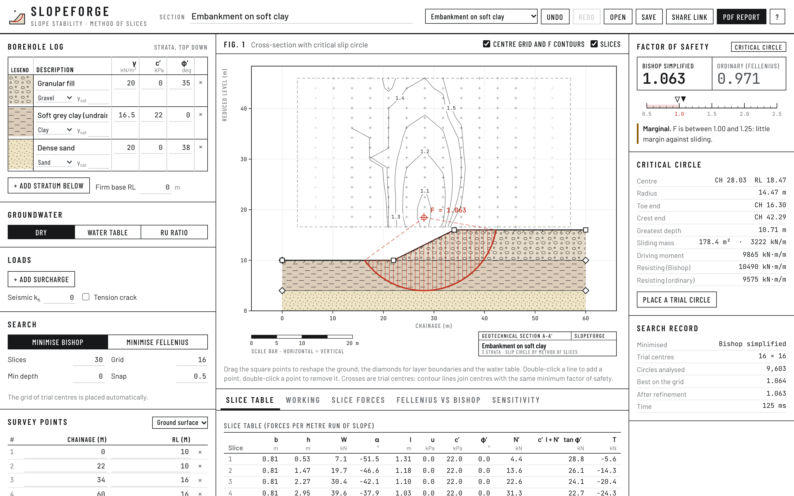
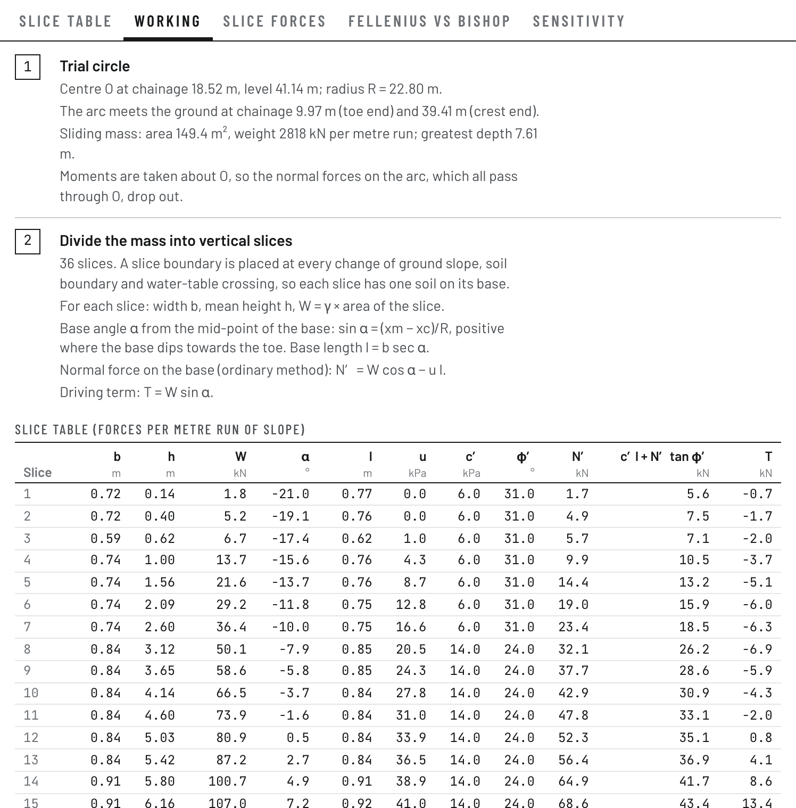
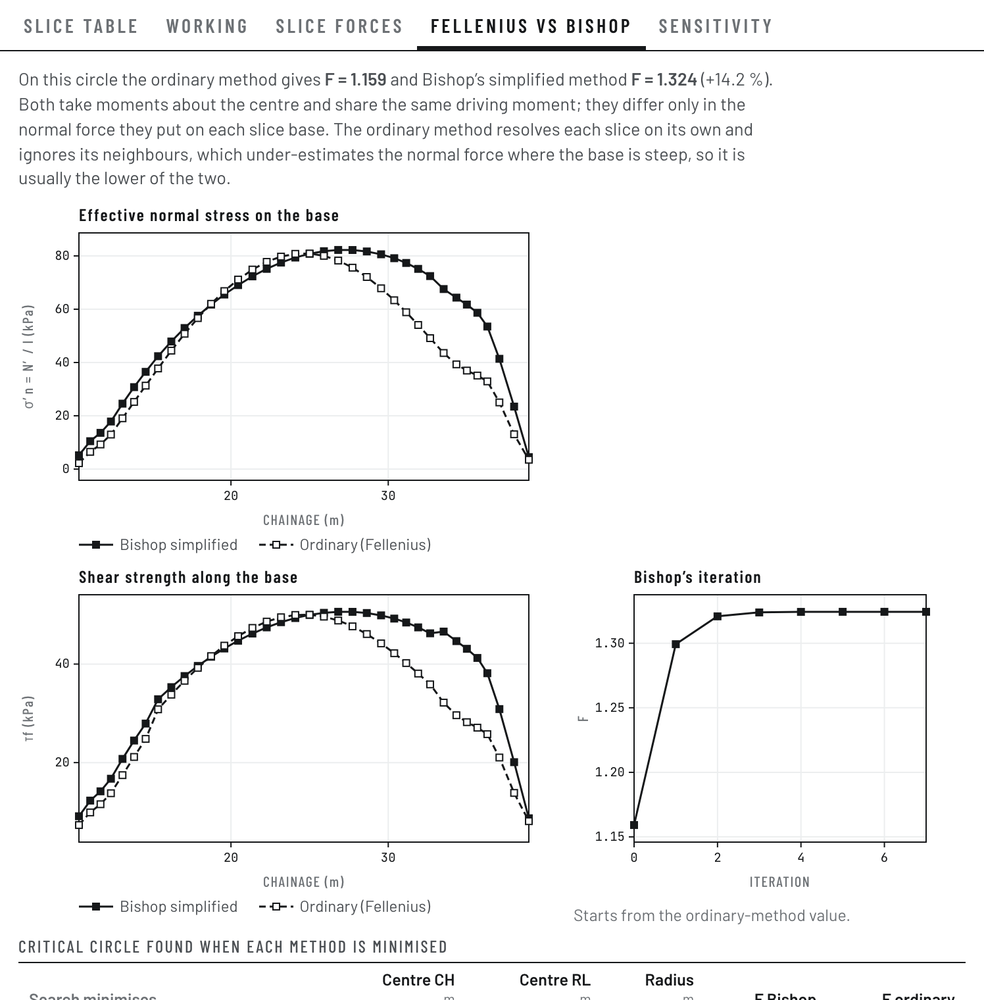
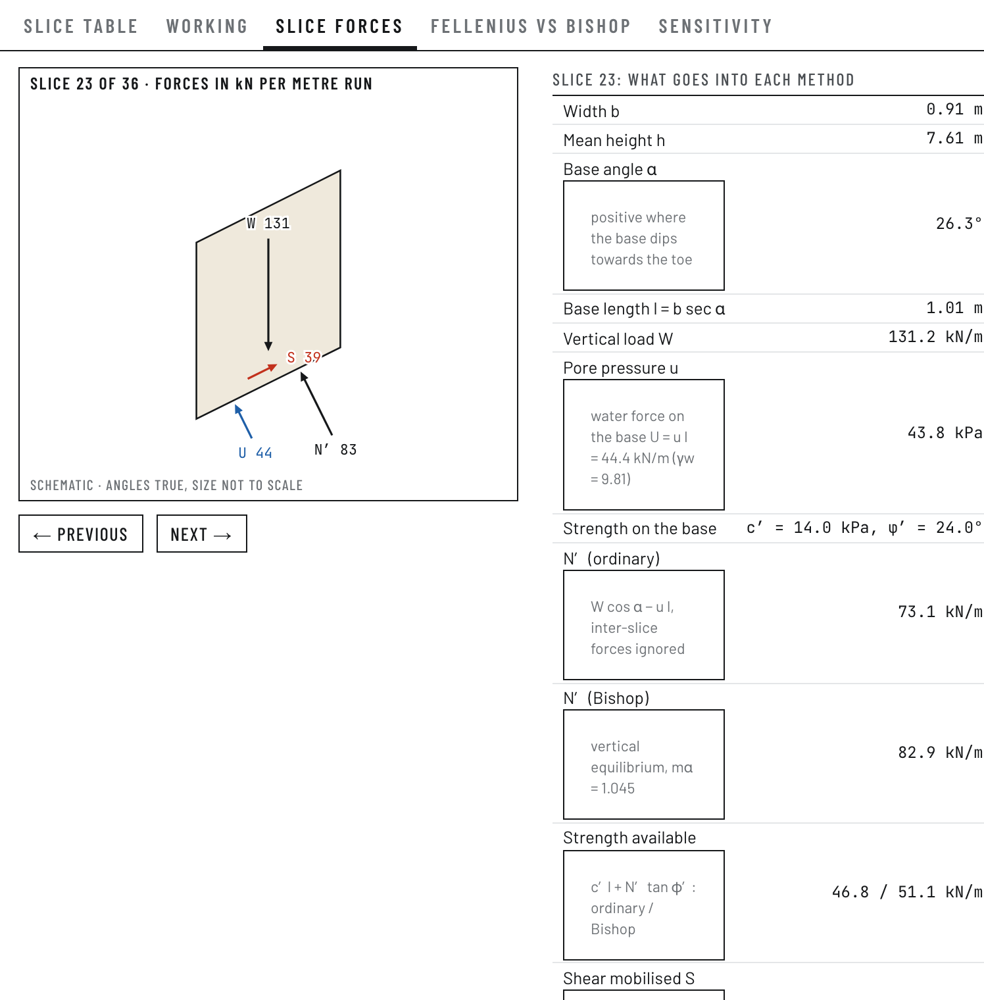
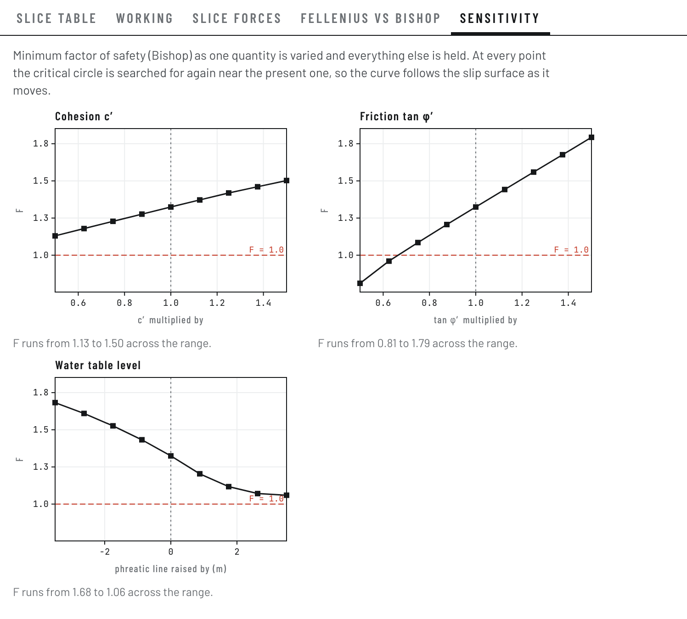
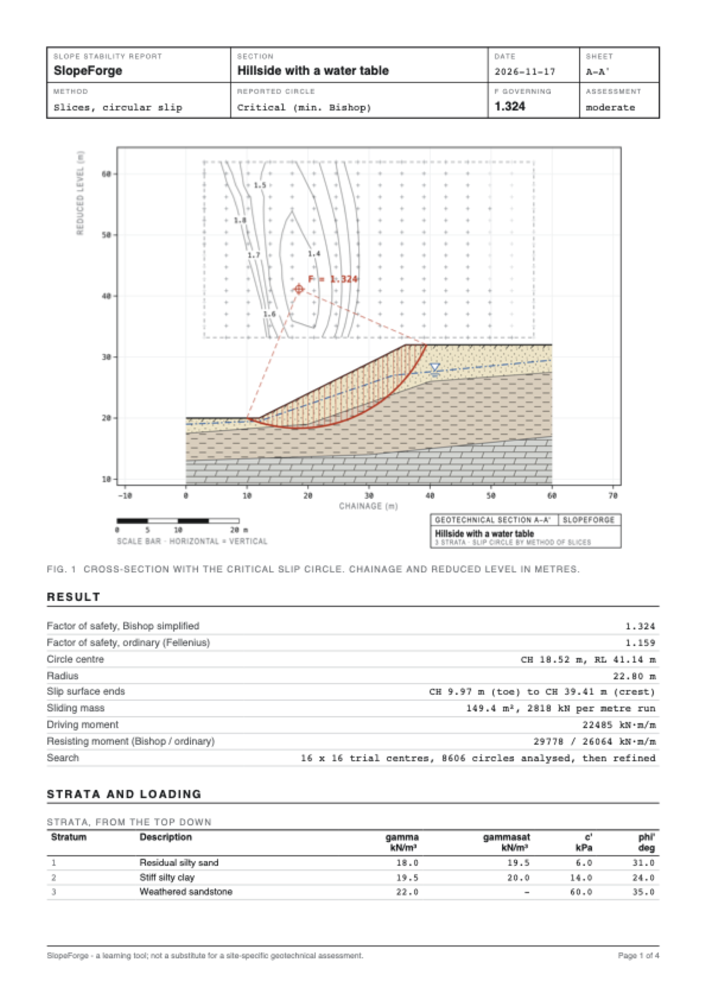
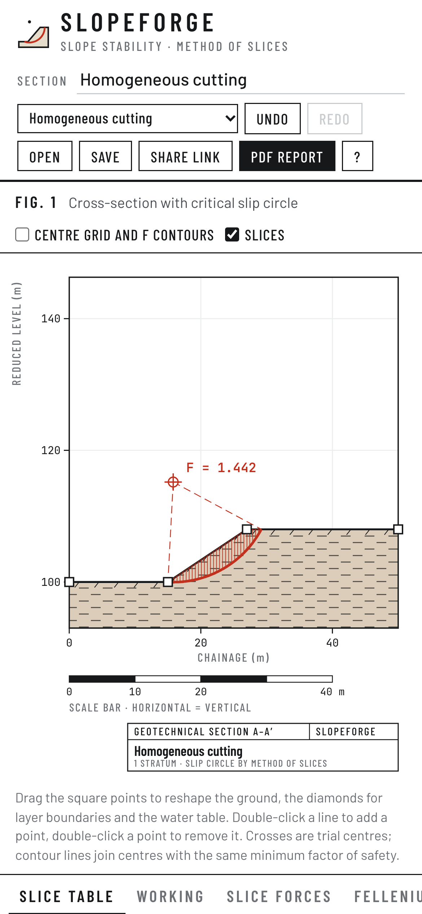
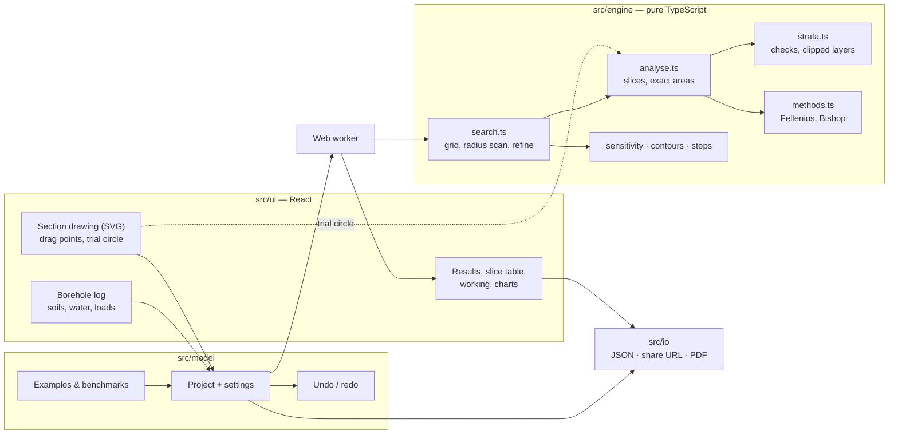

<div align="center">

# SlopeForge

**Slope stability in the browser, drawn like a site-investigation section.**

Draw a slope and its soil strata, set the water table, and find the critical slip circle and its
factor of safety by the method of slices — with every slice, every force and every step of
Bishop's iteration written out. No install, no licence, nothing uploaded.

### [Open SlopeForge](https://wrucebayne29.github.io/slopeforge/)

[](https://github.com/WruceBayne29/slopeforge/actions/workflows/ci.yml)
[](https://github.com/WruceBayne29/slopeforge/actions/workflows/deploy.yml)
[](LICENSE)



</div>

## Why

Slope stability is usually taught with a few slices drawn by hand on graph paper, and analysed in
practice with expensive software that shows only the answer. SlopeForge sits between the two: it
does the full search for the critical circle, and then shows the calculation the way it is done
in a classroom — the slice table, the ordinary-method sum, and Bishop's iteration step by step.
Drag the water table up and you can watch the critical circle move and the factor of safety fall.

It is the third tool in a set with [FrameForge](https://github.com/WruceBayne29/frameforge)
(structural analysis of frames and trusses) and [RCForge](https://github.com/WruceBayne29/rcforge)
(reinforced concrete design to IS 456).

## Features

**Section editor**

- Ground surface and layer boundaries as polylines: drag points, double-click a line to add one,
  double-click a point (or press Delete) to remove it, nudge with the arrow keys, snap to a grid
- Strata in a table laid out like a **borehole log**: hatch, description, γ, γsat, c′, φ′
- Groundwater as a **phreatic line** you drag, or as a pore pressure ratio **r<sub>u</sub>**;
  water standing in front of a slope is carried as a surface load
- Strip **surcharges**, a pseudo-static **seismic coefficient** and a water-filled **tension crack**
- Unlimited undo and redo; nine worked examples, including the ACADS benchmark slopes

**Analysis**

- **Ordinary (Fellenius)** and **Bishop's simplified** methods on circular slip surfaces
- Exact slice weights: slice boundaries fall at every vertex and every crossing, and the area under
  the arc is integrated analytically
- **Critical circle search**: a grid of centres, a radius scan with golden-section refinement at
  each, then a compass search from the best minima; runs in a web worker in a fraction of a second
- Clear messages for circles that cannot be analysed, Bishop iterations that do not converge,
  m<sub>α</sub> ≤ 0, negative normal forces and soils with no strength

**Results**

- The critical circle drawn on the section with its slices, and a **contour map of F** over the
  grid of trial centres
- Place a **trial circle** of your own and drag its centre and radius
- **Slice table**, the **working** written out as a hand calculation, the **forces on any slice**,
  **Fellenius against Bishop** (normal stress, shear strength, the iteration, both searches), and
  **sensitivity** of F to c′, tan φ′ and the water level
- **PDF report** with the drawing, strata, result and full working; **JSON** save and open;
  **share links** that carry the whole section in the URL

| | |
| --- | --- |
|  |  |
| ACADS 1(c) benchmark: F = 1.403 (published 1.39–1.405) | Embankment on undrained soft clay |
|  |  |
| The working, as a hand calculation | Fellenius against Bishop |
|  |  |
| Forces on a slice | Sensitivity |
|  |  |
| PDF report | On a phone |

## How it works

The soil above a circular arc is treated as a rigid block about to rotate about the centre O.
Taking moments about O, the normal forces on the arc drop out, and

$$
F = \frac{\sum \left(c' l + N' \tan\phi'\right)}{\sum W \sin\alpha}
$$

The two methods differ in N′, the effective normal force on each slice base.

**Ordinary method** — ignore the forces between slices and resolve perpendicular to the base:

$$
N' = W\cos\alpha - u l
$$

**Bishop's simplified method** — keep the horizontal inter-slice forces and resolve vertically,
which puts F on both sides; it is solved by iteration from the ordinary-method value:

$$
F = \frac{\sum \left[c' b + (W - u b)\tan\phi'\right] / m_\alpha}{\sum W\sin\alpha},
\qquad m_\alpha = \cos\alpha\left(1 + \frac{\tan\alpha\tan\phi'}{F}\right)
$$

Pore pressure is γ<sub>w</sub> × depth below the phreatic line (or r<sub>u</sub> γh), the seismic
force kh W acts at each slice's centroid, and a tension crack truncates the surface and adds its
water thrust. The critical circle is the minimum over a search of centres and radii. The full
derivation, every assumption and what is not modelled are in **[docs/THEORY.md](docs/THEORY.md)**.

## Validation

The engine is checked against published benchmarks, closed forms that use no slices at all, and a
hand calculation written out slice by slice in the test file. The suite runs on every push, and
[VALIDATION.md](VALIDATION.md) — generated from it — lists every value, its source, the tolerance
allowed and why, and states plainly which reference numbers were recalled from memory.

<!-- validation:start -->
**70 values in 6 groups.**

| # | What is checked | Basis | Values |
| --- | --- | --- | ---: |
| V1 | φ = 0 slopes against Taylor’s stability numbers | published | 4 |
| V2 | φ = 0: slices against the exact moment solution | closed form | 12 |
| V3 | Dry homogeneous slope checked slice by slice | hand calculation | 36 |
| V4 | Long shallow circle against the infinite-slope formula | closed form | 9 |
| V5 | Submerged slope against the buoyant-weight analysis | cross-check | 3 |
| V6 | ACADS benchmark slopes 1(a), 1(c) and 1(d) | published | 6 |
<!-- validation:end -->

Headline results, Bishop's simplified method with a full search:

| Benchmark | Published | SlopeForge |
| --- | ---: | ---: |
| Taylor φ = 0 stability number, 90° / 75° / 60° slope | 0.261 / 0.219 / 0.191 | 0.261 / 0.219 / 0.191 |
| ACADS 1(a), homogeneous slope | 1.00 (Bishop 0.987) | 0.985 |
| ACADS 1(c), three layers | 1.39 (Bishop 1.405) | 1.403 |
| ACADS 1(d), three layers, kh = 0.15 | 1.00 (Bishop 1.015) | 1.013 |

## Architecture



The engine in `src/engine` has no React or DOM and no geotechnical libraries; it is written from
scratch and keeps above 90 % test coverage (currently about 99 %). The search runs in a web worker
so the drawing stays responsive while you drag.

## Develop

```bash
npm install
npm run dev          # http://localhost:5173
npm run check        # lint, format, tests, build
npm run coverage     # coverage, with thresholds on src/engine
npm run validation   # regenerate VALIDATION.md
npm run e2e          # Playwright end-to-end checks against the live site
```

See [CONTRIBUTING.md](CONTRIBUTING.md) for how the code is arranged and the rules for tests.

## Roadmap

- Janbu's simplified method and Spencer's method (force and moment equilibrium)
- Non-circular slip surfaces and a block search along weak layers
- Strength increasing with depth for normally consolidated clay
- Piezometric lines per stratum and a simple flow-net seepage solution
- Reinforcement and anchors
- Probabilistic analysis (Monte Carlo on c′ and φ′)

## Honest limits

SlopeForge is a learning tool. It analyses circular surfaces by two limit-equilibrium methods in
plane strain, takes the water table as an input rather than solving for seepage, and does not
apply partial factors. It is not a substitute for a site-specific geotechnical assessment.

## Credits

Specified by a first-year Civil Engineering student at BITS Pilani; the code was written by an AI
coding agent (Claude Code) working from that specification. MIT licensed.
